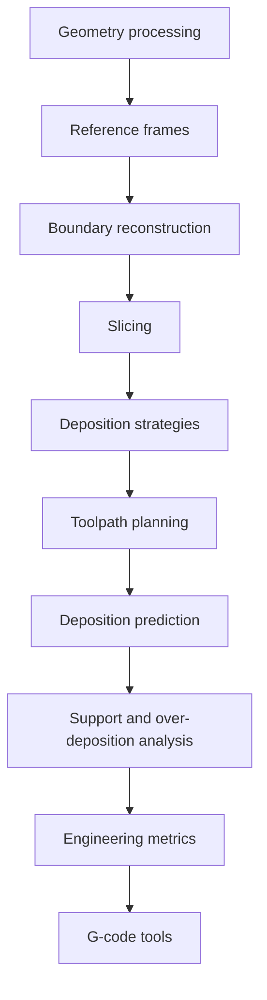

# AS4RCSD — Computational Manufacturing Tools for Repair by Directed Energy Deposition

AS4RCSD (Advanced Strategies for Repairing Complex Surface Damages) is a
**collection of independent computational manufacturing tools**, not a single
script. Each tool covers one stage of the geometry-aware repair workflow for
additive repair of damaged components: from geometry processing and reference
frame definition, through slicing and deposition strategy generation, to
toolpath planning, deposition prediction, engineering metrics, and G-code
generation for machine execution.

The tools can be used individually as importable Python modules
(`src/<area>/`), run from the command line (`scripts/`), or studied through
small self-contained examples (`examples/`). Research investigations that
produced the published comparisons live under `experiments/` and are kept as
version history rather than being folded into the library.

## Computational stack



Each stage consumes the output of the previous one, but every stage is usable
on its own: slicing accepts any mesh, the metrics accept any toolpath, and the
G-code tools accept any trajectory CSV.

## Components

### Geometry processing

Boolean comparison of a nominal part against its damaged counterpart to isolate
the missing volume, mesh alignment (PCA, cross-section, feature matching, ICP),
bounding-box and coordinate analyses.

- Library: `src/geometry/`
- Studies: `experiments/geometry/` (`BC.py`, `BC2.py`, `DamageRec.py`,
  `analyze_bb.py`, `analyze_stl_coordinates.py`)
- Inputs: nominal and damaged STL meshes, point clouds (PCD)
- Outputs: extracted repair-volume meshes and point clouds

### Reference frames

Coordinate-frame handling between the CAD frame, the part frame, and the machine
frame: rigid rotations of meshes and point sets, axis remapping, and offsets.

- Library: `src/reference_frames/transformations.py` —
  `rotate_mesh`, `rotate_points`, `transform_coordinates`, `rotate_coordinates`
- Inputs: meshes or point arrays plus rotation angles, axis remaps, offsets
- Outputs: transformed meshes/point arrays in the target frame

### Boundary reconstruction

Reconstruction of the per-layer repair boundary and of the non-planar substrate
contour that the first deposited layer must follow. This is what lets the
deposition strategies respect a curved, damaged surface instead of a flat bed.

- Library: `src/deposition/` together with the contour handling in
  `src/toolpath/generator.py`
- Studies: `experiments/deposition_strategies/test_contour_detection.py`
- Inputs: sliced boundary points, the non-planar substrate surface mesh
- Outputs: ordered boundary contours per layer

### Slicing

Slicing of the repair volume along Z into layer boundaries at a configurable
layer height, with optional extra layers above the mesh top.

- Library: `src/slicing/` — `slice_mesh`, `extract_slice`
- Inputs: an Open3D `TriangleMesh`, a layer height in millimetres
- Outputs: a list of `(layer_height, boundary_points)` pairs

### Deposition strategies

Six in-plane filling strategies generated per layer, selected by the `strategy`
field of the configuration:

| `strategy` | Name | Character |
|---|---|---|
| 1 | Raster | Parallel deposition lines, travel moves between lines |
| 2 | Zig-zag | Continuous alternating lines, optional corner fillets |
| 3 | Contour | Inward contour-parallel offsets |
| 4 | Spiral | One continuous inward spiral |
| 5 | Hybrid 1 | Contour perimeter plus zig-zag infill |
| 6 | Hybrid 2 | Contour-following offsets with extension and inner offset |

- Library: `src/toolpath/generator.py` (`generate_raster_toolpath`,
  `generate_zigzag_toolpath`, `generate_contour_toolpath`,
  `generate_spiral_toolpath`, `generate_hybrid1_toolpath`,
  `generate_hybrid2_toolpath`)
- Studies: `experiments/deposition_strategies/`,
  `experiments/toolpath_planning/` (AS4RCSD.py … AS4RCSD4.py version history)
- Inputs: layer boundary points, `tool_width`, `hatch_distance`, `raster_angle`
- Outputs: per-layer `(deposition, tool_moves, fly_lines, fillets)` arrays

### Toolpath planning

Orchestration of the full pipeline: load meshes, apply transforms, slice,
generate the chosen strategy per layer, project onto the non-planar surface,
add fly-in/fly-out moves, and export the 3D trajectory.

- Library: `src/toolpath/` — `ToolpathConfig`, `ToolpathGenerator`,
  `default_config`
- Entry point: `scripts/toolpath/run_pipeline.py`
- Inputs: a JSON configuration (or CLI overrides) naming the repair volume mesh,
  the substrate surface mesh, and the process parameters
- Outputs: `toolpath_trajectory.csv`, per-layer CSVs, plots, and the effective
  configuration as JSON

### Deposition prediction

Layer-by-layer prediction of what the planned toolpath actually deposits: the
trajectory is rasterized onto a grid at `grid_size` resolution and accumulated
so that deposited, re-deposited, and empty regions can be distinguished. A
kinematic animation of the same trajectory is available separately.

- Library: `src/deposition/simulation.py` — `import_trajectory_from_csv`,
  `simulate_deposition`, `simulate_material_deposition`; grid prediction in
  `src/toolpath/generator.py`
- Inputs: a trajectory (CSV or in-memory array), `tool_width`, `grid_size`
- Outputs: per-layer deposition grids and colour maps, trajectory animations

### Support and over-deposition analysis

Analysis of whether each deposited segment is laterally supported by material
already present (previous layer or adjacent bead) and where material is laid
down more than once. These drive the wall-engagement and contour-support
measures used to compare strategies.

- Library: `src/evaluation/`, with the grid analysis in
  `src/toolpath/generator.py`
- Inputs: per-layer deposition grids and the layer boundary
- Outputs: `supported_deposition_pct`, `supporting_contour_pct`,
  `over_deposition_pct`, `wall_engagement_index`

### Engineering metrics

Quantitative, per-layer and per-strategy measures used to compare deposition
strategies. Numerical behaviour is preserved exactly from the original
`evaluation_metrics.py`.

| Metric | Input | Output | Interpretation |
|---|---|---|---|
| Deposition length | Deposition segments | mm | Total material-laying travel |
| Travel length | Tool moves and fly lines | mm | Non-productive travel |
| Deposition/travel ratio | Both lengths | ratio | Higher is more efficient |
| Average turn angle | Deposition polyline | degrees | Lower means smoother motion, fewer decelerations |
| CANPD | Layer boundary and deposition | mm | Centroid-based average nearest-point deviation from the target boundary; lower is a closer boundary match |
| Coverage % | Deposition grid | % | Share of the layer area actually covered |
| Over-deposition % | Deposition grid | % | Share of area receiving excess material |
| Supported deposition % | Deposition and support grids | % | Share deposited onto supporting material |
| Supporting contour % | Contour and deposition grids | % | Share of the contour that supports later beads |
| Wall engagement index | Support timing grid | 0–1 | How early deposition engages the existing wall |

- Library: `src/evaluation/` — `calculate_total_length`,
  `deposition_to_travel_ratio`, `turn_angle_analysis`,
  `centroid_based_distance_per_layer` (CANPD), `calculate_centroid`,
  `radial_sample`, `calculate_deposition_color_map`
- Entry point: `scripts/evaluation/batch_evaluate.py`
- Details: `docs/evaluation.md`

### G-code tools

Conversion of planned trajectories into machine G-code, parsing of G-code back
into coordinates, and interactive editing/visualization of a repair program.

- Library: `src/gcode/converter.py` — `GCodeConverter` (`load_csv`,
  `convert_to_gcode`, `parse_gcode`, `get_available_layers`,
  `get_gcode_coordinates`), UI-free
- Entry points: `scripts/gcode/gcode_editor.py`,
  `scripts/gcode/repair_editor.py`,
  `scripts/visualization/repair_visualizer.py`
- Inputs: a toolpath CSV with `X, Y, Z, Layer, Type` columns, or a `.gcode` file
- Outputs: G-code (G00 travel / G01 deposition) and parsed coordinate arrays

## Repository structure

Each functional area maps to one directory:

| Functional area | Library | Entry points | Experiments |
|---|---|---|---|
| Geometry processing | `src/geometry/` | — | `experiments/geometry/` |
| Reference frames | `src/reference_frames/` | — | — |
| Slicing | `src/slicing/` | `examples/slicing/` | — |
| Deposition (strategies, prediction) | `src/deposition/` | `examples/toolpath/` | `experiments/deposition_strategies/` |
| Toolpath planning | `src/toolpath/` | `scripts/toolpath/` | `experiments/toolpath_planning/` |
| Evaluation (metrics, support) | `src/evaluation/` | `scripts/evaluation/` | — |
| G-code | `src/gcode/` | `scripts/gcode/`, `examples/gcode/` | — |
| Visualization | `src/visualization/` | `scripts/visualization/` | `experiments/gui_prototypes/` |

```
clear_repo/
├── README.md               # this file
├── requirements.txt        # third-party packages imported by src/, scripts/, examples/
├── src/                    # importable library code, one package per functional area
├── scripts/                # command-line entry points
├── experiments/            # research investigations and version history
├── examples/               # minimal, self-contained usage demonstrations
├── results/                # small curated outputs (bulk output is ignored by git)
├── docs/                   # per-area documentation and the functionality inventory
└── tests/                  # unit and property-based tests
```

Library modules take every input as a function argument or configuration value;
default data locations are expressed relative to the repository root, so nothing
is tied to a particular machine.

## Research context

AS4RCSD is the **process-planning** stage of a three-repository research
workflow. It consumes geometry and produces executable deposition programs; it
does not duplicate the code of the upstream repositories.

- **Damage detection** (separate repository): acquires and processes scans of a
  damaged component and segments the damaged region from point-cloud data. The
  RAN-3D voxel processing experiment kept here in
  `experiments/damage_detection/ran3d.py` documents the interface to that work;
  the production implementation lives upstream.
- **Geometry reconstruction** (separate repository): reconstructs the nominal
  surface and derives the repair volume as the boolean difference between the
  nominal and damaged geometry. The comparison studies in
  `experiments/geometry/` (`BC.py`, `BC2.py`, `DamageRec.py`) document how that
  output is validated before planning; the production implementation lives
  upstream.
- **This repository (AS4RCSD)**: takes the reconstructed repair volume and the
  non-planar substrate surface as STL input, plans the layer-wise deposition,
  predicts and evaluates the result, and emits G-code.

The contract between repositories is therefore a pair of meshes — the repair
volume and the substrate surface — which keeps the three codebases independently
runnable.

## Installation

Requires Python 3.10 or newer.

```bash
git clone <repository-url>
cd <repository>/clear_repo
python -m venv venv
source venv/bin/activate        # Windows: venv\Scripts\activate
pip install -r requirements.txt
```

Verify the installation by running the test suite from `clear_repo/`:

```bash
python -m pytest
```

The GUI entry points additionally need Tkinter (`python3-tk` on Debian/Ubuntu)
and a display.

## Usage

Run every command from the `clear_repo/` directory.

Toolpath pipeline — generate a trajectory from a configuration:

```bash
python scripts/toolpath/run_pipeline.py --config example_config.json
python scripts/toolpath/run_pipeline.py \
    --mesh-file ../Data/Toolpath_Models/Model_C_R.STL \
    --non-planar-surface ../Data/Toolpath_Models/Model_C_S.STL \
    --output-dir results/toolpath/run1
```

Batch evaluation — run one case per JSON configuration and collect the metrics
into a CSV plus a text summary:

```bash
python scripts/evaluation/batch_evaluate.py --configs configs/ --output-dir results/batch
```

G-code editor — convert and edit a trajectory interactively:

```bash
python scripts/gcode/gcode_editor.py --csv results/toolpath/toolpath_trajectory.csv
```

Repair editor — inspect a repair program against the part geometry:

```bash
python scripts/gcode/repair_editor.py \
    --gcode results/toolpath/toolpath_trajectory.csv \
    --damaged ../Data/Toolpath_Models/Model_C_S.STL \
    --repair ../Data/Toolpath_Models/Model_C_R.STL
```

Repair visualizer — animate the repair process:

```bash
python scripts/visualization/repair_visualizer.py \
    --damaged ../Data/Toolpath_Models/Model_C_S.STL \
    --repair ../Data/Toolpath_Models/Model_C_R.STL \
    --gcode results/toolpath/toolpath_trajectory.csv
```

Examples — each is a single self-contained script:

```bash
python examples/slicing/slice_stl.py --layer-height 0.5 --max-layers 5
python examples/toolpath/simulate_trajectory.py --summary-only
python examples/gcode/csv_to_gcode.py --output results/example.gcode
```

Library use:

```python
from src.slicing import slice_mesh
from src.evaluation import deposition_to_travel_ratio

slices = slice_mesh(mesh, layer_height=0.5)
ratio = deposition_to_travel_ratio(deposition_length, travel_length)
```

## Documentation

- `docs/functionality_inventory.md` — every original source file with its
  purpose, inputs, outputs, dependencies, and classification
- `docs/architecture.md` — how the functional areas fit together
- `docs/slicing.md`, `docs/toolpath_planning.md`,
  `docs/deposition_strategies.md`, `docs/coordinate_transformations.md`,
  `docs/evaluation.md` — per-area purpose, inputs, processing, outputs, example
  invocation, and dependencies
