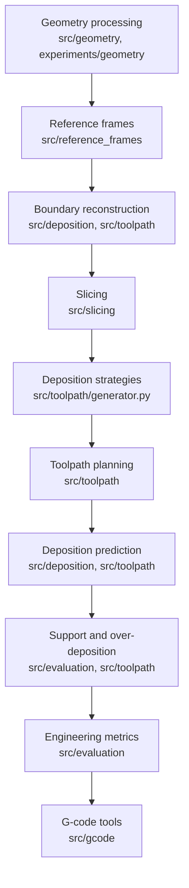

# Architecture

## Purpose

Describe how the AS4RCSD functional areas fit together, so a reader can locate
the code for any stage of the repair workflow and understand what each stage
hands to the next. This document is the map; the other files in `docs/` describe
individual areas in detail.

## Inputs

- A repair volume mesh (STL): the material that must be added back to the
  damaged component, normally produced upstream as the boolean difference
  between nominal and damaged geometry.
- A non-planar substrate surface mesh (STL): the damaged surface that the first
  deposited layer must follow.
- A process configuration (`ToolpathConfig`, JSON or Python) holding layer
  height, strategy selection, tool width, hatch distance, transforms, grid
  resolution, and output locations.

## Processing

The functional areas form a pipeline, but each area is usable on its own.



1. **Geometry processing** isolates the repair volume and aligns meshes.
2. **Reference frames** moves geometry between the CAD, part, and machine frames
   (offsets, axis remaps, rotations).
3. **Boundary reconstruction** derives the per-layer repair boundary and the
   non-planar substrate contour the first layer follows.
4. **Slicing** cuts the repair volume along Z at the configured layer height.
5. **Deposition strategies** fill each layer boundary using one of six patterns.
6. **Toolpath planning** orchestrates the above, projects the in-plane path onto
   the non-planar surface, adds fly-in/fly-out moves, and exports the
   trajectory.
7. **Deposition prediction** rasterizes the planned path onto a grid to estimate
   what is actually deposited.
8. **Support and over-deposition analysis** classifies grid cells as supported,
   covered, or over-deposited.
9. **Engineering metrics** reduce the prediction to comparable numbers.
10. **G-code tools** convert the trajectory into machine instructions.

Layering rule: `src/` holds importable library code with no interactive prompts
and no machine-specific paths; `scripts/` holds command-line entry points;
`experiments/` holds research investigations and version history; `examples/`
holds minimal self-contained demonstrations.

## Outputs

- `toolpath_trajectory.csv` — the complete 3D trajectory with layer and move
  type per point.
- Per-layer toolpath CSVs and plots.
- Evaluation JSON/text metric records per layer and per strategy.
- G-code programs (`G00` travel, `G01` deposition).
- The effective configuration, serialized as JSON next to the results.

## Example

Run the whole stack for one configuration, then evaluate a batch:

```bash
cd clear_repo
python scripts/toolpath/run_pipeline.py --config example_config.json
python scripts/evaluation/batch_evaluate.py --configs configs/ --output-dir results/batch
```

Use a single stage from Python:

```python
from src.slicing import slice_mesh
from src.evaluation import deposition_to_travel_ratio
```

## Dependencies

open3d, numpy, scipy, shapely, trimesh, pyvista, matplotlib, scikit-learn,
geomdl, sympy, pandas. GUI entry points additionally require Tkinter and a
display. Install with `pip install -r requirements.txt`.
